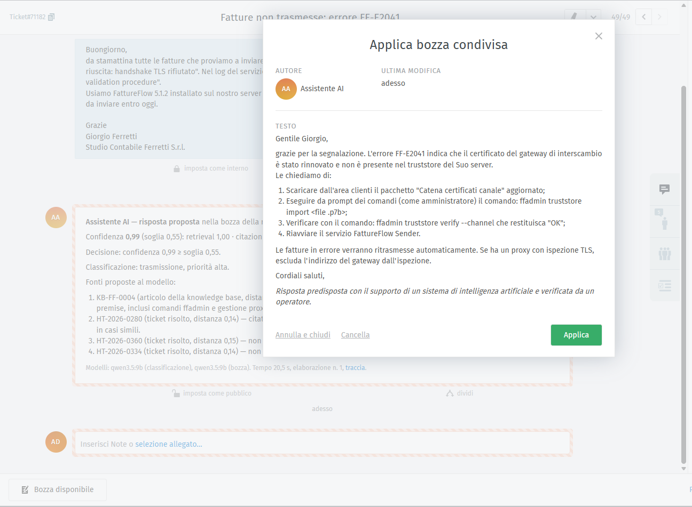
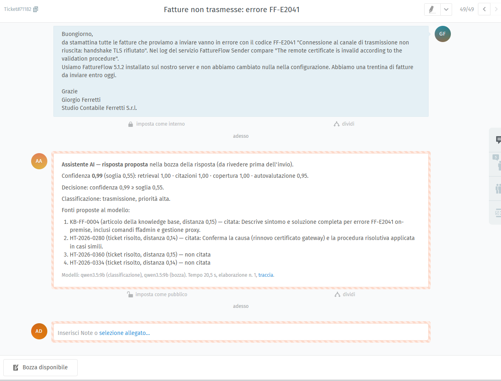
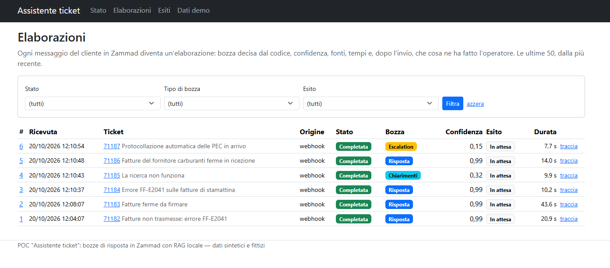
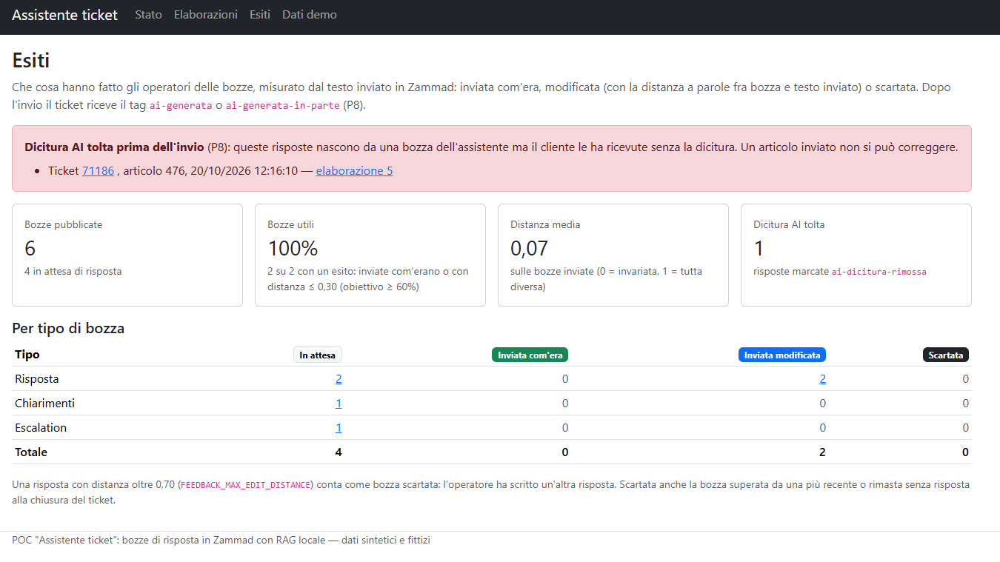

# AI.POC-AssistenteTicket

**Draft replies inside Zammad, grounded in past tickets and the knowledge base, with a local model.**

*[Leggi in italiano](README.it.md)*

A proof of concept: when a customer writes to the helpdesk, an assistant retrieves similar resolved tickets, knowledge base
articles and release notes, and proposes a **reply draft with its sources** to the agent, right inside
[Zammad](https://zammad.org) (open source helpdesk) as a shared draft. The agent edits and sends it with Zammad's own controls:
nothing is ever sent automatically. Everything runs locally: models on Ollama, data on SQL Server LocalDB, Zammad in Docker
inside WSL.

> **Status: Phase 8 — evaluation, documentation and demo.** A new customer message in Zammad (webhook, polling or manual start)
> gets, within ~10–20 s, a shared draft in the reply editor with the AI disclosure, an internal note with sources and confidence,
> and the `ai-bozza` tag: an answer, a request for clarification or an escalation, decided by code. When the agent sends the
> reply, the Agent service compares it with the draft, records the outcome and tags the ticket `ai-generata` or
> `ai-generata-in-parte`; it flags replies whose AI disclosure was removed. The console shows runs, outcomes and demo data. All
> data is synthetic and fictitious.
>
> For non-developers: [the project in brief](docs/il-progetto-in-breve.md) (Italian). To present it: [the demo](docs/demo.md) (Italian).

What it adds to the other POCs of the series (Order-to-Cash, Claims assistant, Digital transport):

1. integration with a real third-party product (Zammad) instead of a simulated system;
2. human in the loop inside the agent's own tool: no new UI to learn;
3. hybrid retrieval (lexical BM25 + vector, Reciprocal Rank Fusion) with version applicability filters;
4. usefulness measured from the agent's actual behaviour (distance between draft and sent text).

| | |
|---|---|
|  |  |
| *Scenario 1: the draft in the Zammad editor, with the AI disclosure added by the code* | *The internal note for the agent: confidence, decision, cited sources and why* |
|  |  |
| *Console: the six demo scenarios, answer, clarification or escalation decided by the code* | *Console: what the agents did with the drafts, with a warning for a removed AI disclosure* |

More screenshots in the [demo](docs/demo.md#schermate) (Italian). The UI and the data are in Italian.

## Results

Measured on 2026-10-19 on test-set tickets kept out of the index, with `qwen3.5:9b` running locally (reports in [eval/](eval)):

| Criterion (PLAN §1) | Result | Threshold |
|---|---|---|
| Retrieval: a source of the same case in the top 5 (hit@5) | **100%** of 135 tickets (97% on the symptom paraphrase alone), MRR@10 1.000 | ≥ 80% |
| Useful drafts (send as is or with small edits), manual grid on 30 cases | **26 of 30 (86.7%)** — grades proposed by Claude, to be reviewed | ≥ 60% |
| Technical terms not supported by the sources in proposed drafts | **0 of 35** | < 5% |
| Latency from the customer message to the draft in Zammad | **9–20 s** live (6 scenarios); dry-run pipeline mean 9.9 s, p95 13.0 s | < 45 s |
| Repeatable demo with the scenarios | 6 of 6 with the expected outcome, from `DbInit` onwards | yes |

The 30 graded cases are the 15 traps of the test set (vague, no history, malicious instructions, wrong mode or version,
ambiguous product) plus 15 regular cases stratified by product and mode; the 4 drafts to discard are all traps.

**Cloud comparison** (same 30 cases, same pipeline, same grid proposed by Claude; synthetic data):

| | `qwen3.5:9b` local | `claude-haiku-5-5` |
|---|---|---|
| Useful drafts | 26 of 30 (86.7%): 18 correct, 8 with edits, 4 to discard | **28 of 30 (93.3%)**: 19 correct, 9 with edits, 2 to discard |
| Traps meeting the automatic expectation | 6 of 7 (one vague ticket answered) | **7 of 7** |
| Decisions: answer / clarification / escalation | 26 / 2 / 2 | 21 / 8 / 1 |
| Unsupported technical terms | 0 of 35 | 0 of 35 |
| Mean pipeline time (p95) | **9.9 s** (13.0 s) | 12.7 s (16.7 s) |
| Cost for 30 cases | 0 (local) | $0.046 (155K input tokens, 62K output) |

The cloud model asks for clarification more often before proposing a fix: it avoids wrong answers on the traps, but in two
regular cases it asks when the answer was already in the sources. The local model answers more and sometimes slips into "voi".

Measured again on 2026-10-21, after the customer questions were appended to answers too: 27/30 useful drafts locally and 29/30
with the cloud model, same timings (`eval/drafts-2026-10-21-*`).

```powershell
dotnet run --project tools/Dusiburg.AI.Ticket.Cli -- eval retrieval                       # hit@k and MRR, retrieval variants
dotnet run --project tools/Dusiburg.AI.Ticket.Cli -- eval drafts                          # drafts on the 30 cases (~5 min), report, readings and empty grid
dotnet run --project tools/Dusiburg.AI.Ticket.Cli -- eval drafts --replay eval/drafts-<date>-qwen3.5-9b.json --griglia eval/griglia-<date>-qwen3.5-9b.json
dotnet run --project tools/Dusiburg.AI.Ticket.Cli -- eval drafts --provider anthropic     # cloud comparison (~6 min, ~$0.05): needs Parameters:anthropic-api-key
dotnet run --project tools/Dusiburg.AI.Ticket.Cli -- eval drafts --modo agente            # agent mode with tools (~13 min, AppHost running)
```

### Limitations

- **Simulated data**: tidier than real data, and tickets of the same case share subjects and details (the full query saturates
  retrieval); in the test set the contact name does not always match the signature in the text.
- **A 9B model on 8 GB of VRAM** is the lower bound of quality. Weak spots: a vague ticket answered instead of questioned,
  customers quoting a version other than the affected one, occasional slips from the formal "Lei" to "voi".
- **Manual grid** proposed by the development assistant, to be reviewed by someone who knows the support domain.
- **Polling source** covered by tests, not live; sending from Zammad's editor tried by hand in Phase 0, then simulated with the Cli.
- **AI disclosure**: wording and legal scope to be validated by whoever handles compliance.
- No real authentication or high availability; Zammad in a test configuration.

### Zammad's own AI alongside (optional)

`zammad ai on` switches on Zammad 7.2's native AI on the same `qwen3.5:9b`: ticket summary, the editor's text tools and a triage
agent that sets category, priority and the `zammad-ai-triage` tag. Zammad does not write answers from history, knowledge base
and release notes: that is what the POC adds. On the 6 demo scenarios (2026-10-21) the triage matches our classification on 5
categories and 5 priorities out of 6, in ~5 s; the draft pays +1–2 s of GPU queueing, once Ollama gets the same context size as
the pipeline (with different context sizes the model reloaded on every ticket: +8 s). Prerequisites and commands in
[docs/demo.md](docs/demo.md#ai-di-zammad-facoltativa-fase-9a) (Italian).

### Agent mode with tools (optional)

With `PIPELINE_MODE=agent` the sources are not picked by retrieval: the model searches and reads them with the read-only tools of
the `ticket-mcp` MCP server (hybrid search, full read, release notes, customer history, Zammad search). The code puts product,
version and customer into the calls, caps the number of calls and accepts only citations of sources actually read; verification,
confidence, decision and AI disclosure are those of the fixed pipeline. On the same 30 cases (2026-10-21, grid proposed by
Claude):

| | Fixed · `qwen3.5:9b` | Agent · `qwen3.5:9b` | Fixed · `claude-haiku-5-5` | Agent · `claude-haiku-5-5` |
|---|---|---|---|---|
| Useful drafts | 27/30 | 28/30 | 29/30 | **30/30** |
| Mean time (p95) | **9.9 s** (12.7 s) | 26.8 s (43.1 s) | 13.3 s (16.9 s) | 24.8 s (36.1 s) |
| Cost for 30 cases | 0 | 0 | $0.046 | $0.162 |

The agent solves the version traps whose source was not in the top four (4.8.5 out of support, expired signing certificate), but
takes 2–3 times as long and, with the 9B model, writes worse Italian. The fixed pipeline stays the default. Details in
[docs/architettura.md](docs/architettura.md#modalità-agente-con-i-tool-fase-9b) (Italian).

## Architecture

.NET 10 + Aspire. The `Agent` service owns the database, hosts the model clients and talks to Zammad; the `Web` console shows
service health, runs, draft outcomes and demo data. Zammad runs from the official `zammad-docker-compose` stack inside WSL, started and stopped by the AppHost.
Details in [docs/architettura.md](docs/architettura.md) (Italian).

| Component | Address |
|---|---|
| Aspire dashboard | `https://localhost:17579` |
| Agent | `http://localhost:5401` (all interfaces: Zammad's webhook comes from WSL) |
| Web console | `http://localhost:5402` |
| Zammad | `http://127.0.0.1:8080` |

## How to run

Prerequisites: .NET SDK 10.0.4xx, SQL Server 2025 LocalDB instance `localdev`, [Ollama](https://ollama.com) with
`qwen3.5:9b` and `embeddinggemma`, WSL distro `Ubuntu-26.04` with Docker Engine and Compose, `vm.max_map_count` ≥ 262144
(Elasticsearch).

```powershell
# 1. Connection string in the AppHost user-secrets
dotnet user-secrets set "ConnectionStrings:sql" "Server=(localdb)\localdev;Database=Ticket;Trusted_Connection=True;TrustServerCertificate=True" --project src/Dusiburg.AI.Ticket.AppHost

# 2. Zammad administrator token (Zammad profile > Token Access, permissions admin + ticket.agent)
dotnet user-secrets set "Parameters:zammad-admin-token" "<token>" --project src/Dusiburg.AI.Ticket.AppHost

# 3. Ticket database recreated from the model, with the demo catalog and the synthetic data of data/ (drops the existing one)
dotnet run --project tools/Dusiburg.AI.Ticket.DbInit

# 4. Start: Agent, Web, Zammad in WSL and the Aspire dashboard
dotnet run --project src/Dusiburg.AI.Ticket.AppHost

# 5. With the AppHost running: helpdesk structure, then customers and 80 historical tickets (both idempotent)
dotnet run --project tools/Dusiburg.AI.Ticket.Cli -- zammad bootstrap
dotnet run --project tools/Dusiburg.AI.Ticket.Cli -- zammad seed

# 6. Index: anonymized chunks of resolved tickets, KB articles and release notes with their embeddings (~40 s on CPU)
dotnet run --project tools/Dusiburg.AI.Ticket.Cli -- embed
dotnet run --project tools/Dusiburg.AI.Ticket.Cli -- search --demo 1          # sources found for a demo scenario
dotnet run --project tools/Dusiburg.AI.Ticket.Cli -- eval retrieval           # hit@k and MRR on the test set, report in eval/

# 7. Restart the AppHost (the Agent now uses the ai-assistant token), switch the webhook trigger on, then create the
#    incoming ticket of a demo scenario: the draft appears in Zammad within ~20 s
dotnet run --project tools/Dusiburg.AI.Ticket.Cli -- zammad trigger on
dotnet run --project tools/Dusiburg.AI.Ticket.Cli -- demo 1

# Optional: the pipeline dry-run on a ticket (no write to Zammad), or a manual run published by the Agent
dotnet run --project tools/Dusiburg.AI.Ticket.Cli -- draft 71164
Invoke-RestMethod -Method Post http://localhost:5401/api/runs -ContentType application/json -Body '{"ticketId":170}'

# 8. The agent sends the draft from Zammad's editor (or the Cli plays that part): the outcome and the ai-generata /
#    ai-generata-in-parte tags follow within seconds; the console at http://localhost:5402 shows them under Runs and Outcomes
dotnet run --project tools/Dusiburg.AI.Ticket.Cli -- reply 71171 [--modifica] [--riscrivi] [--senza-dicitura]
dotnet run --project tools/Dusiburg.AI.Ticket.Cli -- close 71171
```

On the very first run the AppHost clones the Zammad stack inside WSL and Docker pulls ~5 GB of images; create the Zammad
administrator from the setup wizard at `http://127.0.0.1:8080`, then create the token. `zammad bootstrap` creates the technical
user `ai-assistant` and writes its token and the webhook secret into the AppHost user-secrets. Closing the AppHost stops the
Zammad containers (`Zammad:StopOnExit=false` keeps them running).

After a `DbInit`, run `zammad seed` again (it relinks organizations and historical tickets to the new database without creating anything).
Model, retrieval and Zammad knobs (`OLLAMA_*`, `MODEL_*_PROVIDER`, `EMBEDDING_*`, `RETRIEVAL_*`, `RRF_K`, `CONFIDENCE_MIN_FOR_DRAFT`, `TICKET_EVENT_SOURCE`, `FEEDBACK_MAX_EDIT_DISTANCE`, `ZAMMAD_URL`, `Zammad:*`) are listed in
[docs/architettura.md](docs/architettura.md#manopole).

### Build and test

```powershell
dotnet build Dusiburg.AI.Ticket.slnx
dotnet test --solution Dusiburg.AI.Ticket.slnx
```

Tests never call Ollama or Zammad (fake HTTP handlers, stub probes); SQL tests use LocalDB `localdev`, each class on its own
database created by `DbInit` and dropped afterwards. The CI (GitHub Actions, Windows) runs the same; when its LocalDB has no
`VECTOR` type it skips the `RequiresSql2025` category.

## Layout

```text
src/       AppHost, ServiceDefaults, Shared, Data, Ai, Rag, Zammad, Core, Agent, Web
tools/     DbInit: recreates the database · DataGen: generates data/tickets.json · Cli: Zammad, demo tickets, index, evaluation, simulated agent
tests/     one NUnit project per area
data/      synthetic data: hand-written cases, KB, release notes, customers; generated tickets (Italian)
eval/      evaluation reports (retrieval, drafts) with readings and grid (Italian)
infra/     zammad/: stack configuration (zammad.env) and start script for WSL
docs/      architecture, demo, project in brief (Italian)
```

## License

MIT, see [LICENSE](LICENSE). The Zammad Docker stack (AGPL-3.0) is not part of this repository: it is cloned at runtime.
