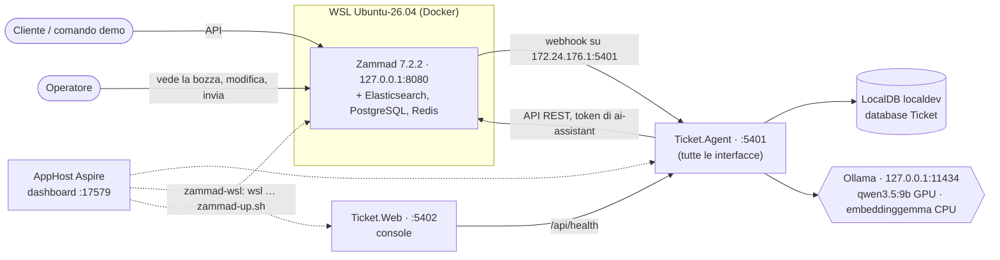

# Assistente ticket — architettura

> Stato: **Fase 1 (scaffolding)**. Il documento cresce fase per fase: le sezioni su dati, retrieval e pipeline arrivano con le
> fasi che li realizzano.

## 1. Che cos'è

Un assistente che legge i nuovi messaggi dei clienti in **Zammad** (helpdesk open source), recupera ticket risolti, articoli
della knowledge base e note di rilascio pertinenti, e propone all'operatore una **bozza di risposta con le fonti citate**,
dentro Zammad come bozza condivisa. L'operatore la modifica e la invia con i controlli nativi di Zammad: nessun invio automatico.
Tutto gira in locale: modelli su Ollama, dati su SQL Server LocalDB, Zammad in Docker dentro WSL.

## 2. Topologia



| Componente | Indirizzo | Note |
|---|---|---|
| AppHost (dashboard) | `https://localhost:17579` | O2C 17279, Sinistri 17379, Trasporto 17479 |
| `Ticket.Agent` | `http://localhost:5401`, in ascolto su `0.0.0.0` | senza il proxy di Aspire, per ricevere il webhook da WSL |
| `Ticket.Web` | `http://localhost:5402` | |
| Zammad | `http://127.0.0.1:8080` | pubblicato solo su localhost di WSL, inoltrato a Windows |
| Ollama | `http://127.0.0.1:11434` | `127.0.0.1` e non `localhost`: ~2 s risparmiati per connessione |

**Rete fra WSL e Windows.** La rete NAT di WSL ha indirizzi fissi nel registro: Windows visto da WSL (e dai container) è
sempre `172.24.176.1`. Il webhook di Zammad chiama `http://172.24.176.1:5401/...`; la regola del firewall di Windows
`WSL -> Helpdesk Agent (TCP 5401)` ammette quella porta solo dalla rete `172.24.176.0/20`. Le connessioni dai container
arrivano con l'indirizzo di WSL (`172.24.186.126`), quindi dentro la regola. `host.docker.internal` con Docker Engine in WSL
non esiste.

## 3. Progetti

| Progetto | Ruolo |
|---|---|
| `Dusiburg.AI.Ticket.AppHost` | Aspire: Agent, Web, Ollama (se non risponde), stack Zammad in WSL, manopole |
| `Dusiburg.AI.Ticket.ServiceDefaults` | OpenTelemetry, health check, resilienza, service discovery, `ApiProblems` |
| `Dusiburg.AI.Ticket.Shared` | enum del dominio, `DemoCatalog`, probe e report di salute, telemetria, JSON, codici d'errore |
| `Dusiburg.AI.Ticket.Data` | EF Core: `TicketDbContext` con gli schemi `support`, `rag`, `agent`, seed del catalogo demo |
| `Dusiburg.AI.Ticket.Ai` | fabbrica dei client di chat per compito, embedding su CPU, `EmbeddingProfile`, `EmbeddingService` (prefissi, batch, retry), cattura dei prompt |
| `Dusiburg.AI.Ticket.Rag` | pulizia e anonimizzazione, chunking, indicizzazione, retrieval ibrido (vettoriale in SQL + BM25 in memoria, RRF), valutazione |
| `Dusiburg.AI.Ticket.Zammad` | client tipizzato dell'API di Zammad, modelli dell'API, probe |
| `Dusiburg.AI.Ticket.Agent` | Minimal API: `/api/health` (compreso l'indice RAG); dalle prossime fasi event source, coda e pipeline |
| `Dusiburg.AI.Ticket.Web` | console Razor Pages: stato dei servizi |
| `tools/Dusiburg.AI.Ticket.DbInit` | ricrea il database dal modello e carica catalogo demo e dati simulati di `data/` |
| `tools/Dusiburg.AI.Ticket.DataGen` | genera `data/tickets.json` dai testi di `data/`, con seed fisso |
| `tools/Dusiburg.AI.Ticket.Cli` | riga di comando: `zammad bootstrap`, `zammad seed`, `demo <n>`, `embed`, `search`, `eval retrieval` |

Arriva con la sua fase: `Core` (Fase 6).

Regole di confine: l'Agent è l'unico proprietario del database; la Web parla solo con l'Agent via HTTP; solo `Ai` conosce i
provider dei modelli e solo `Zammad` conosce l'API di Zammad.

### Database

LocalDB `(localdb)\localdev`, database `Ticket`, un solo `DbContext` (`TicketDbContext`) per tre schemi: l'Agent è l'unico
proprietario, e così le FK fra schemi sono vere. Nessuna migration: `tools/Dusiburg.AI.Ticket.DbInit` cancella e ricrea il
database dal modello; le query vettoriali (Fase 5) sono Dapper con `SqlVector<float>`.

| Schema | Tabelle | Lookup dagli enum |
|---|---|---|
| `support` | `Product`, `ProductVersion` (`Sequence` = ordine di rilascio), `Customer` (chiave `EmailDomain`), `HistoricalTicket` (chiave `Number`, `IsTestSet`, `CaseCode`, `TrapKindId`, `DuplicateOfId`), `TicketMessage`, `Resolution`, `KbArticle` (chiave `Code`), `ReleaseNote` (chiave `Code`) | `DeploymentMode`, `SlaLevel`, `TicketPriority`, `TicketState`, `MessageAuthor`, `ReleaseNoteType`, `TrapKind` |
| `rag` | `Chunk` (fonte, metadati di applicabilità, testo, `Embedding VECTOR(n)`), `EmbeddingInfo` (riga unica: modello e dimensione dei vettori salvati) | `ChunkSource` |
| `agent` | `AgentRun` (univoco su ticket + articolo di Zammad: idempotenza), `AgentDraft` (segnali e confidenza, testo, esito del feedback), `AgentDraftSource` | `RunTrigger`, `AgentRunState`, `DraftKind`, `DraftOutcome` |

- Le chiavi di business (`Number`, `Code`) sono gli id con cui il modello cita le fonti, e la verifica a valle li confronta con
  quelli recuperati.
- Un `Chunk` ha una sola FK verso la fonte (ticket, articolo o nota di rilascio), coerente con `ChunkSourceId`
  (`CK_Chunk_Source`).
- La dimensione di `Embedding` viene da `EMBEDDING_DIMENSIONS` (default 768) al momento di `DbInit`: è un parametro del modello EF,
  che la include nella chiave della cache (i test usano `VECTOR(4)`). Il controllo 4 di `/api/health` segnala se non coincide.

```powershell
dotnet run --project tools/Dusiburg.AI.Ticket.DbInit [-- "<connection string>"] [--no-seed] [--allow-non-local]
```

Senza argomenti usa `ConnectionStrings__sql` o `(localdb)\localdev`; fuori da LocalDB chiede `--allow-non-local`. Il seed
inserisce il catalogo demo (`DemoCatalog`: prodotti FattureFlow e DocuArchive con le versioni, clienti dei sei scenari) e i dati
simulati di `data/` (circa 4 secondi).

### Dati simulati

Tutto è inventato. I testi sono scritti a mano in `data/`; un generatore con seed li combina nei ticket storici (metodo
"ibrido", `fase-3.md` del piano).

| File | Contenuto |
|---|---|
| `scenari/*.json` | 54 **casi**: prodotto × modalità × intervallo di versioni × causa × soluzione, con 3–6 varianti di sintomo (l'ultima riservata al test set), dettagli, domande, risposte e le fonti KB/note pertinenti. I casi trasversali valgono per entrambi i prodotti (64 istanze) |
| `kb/*.json` | 46 articoli divisi in sezioni (i comuni ai due prodotti sono modelli con `{P}` e `{prodotto}`) |
| `note-rilascio.json` | 60 note: novità, correzioni, bug noti con la versione che li corregge |
| `clienti.json` | 34 clienti oltre ai 6 del catalogo demo (40 in tutto, 23 on-premise e 17 SaaS) |
| `rumore.json` | aperture, chiusure, firme, disclaimer, citazioni, nomi dei referenti e degli operatori |
| `trabocchetti.json` | 15 ticket del test set scritti per intero: modalità sbagliata, versione fuori intervallo, nessuno storico, richiesta vaga, istruzioni malevole, prodotto ambiguo |
| `tickets.json` | **generato**: 950 ticket (800 indicizzabili, 150 di test set) |

```powershell
dotnet run --project tools/Dusiburg.AI.Ticket.DataGen            # rigenera data/tickets.json
dotnet run --project tools/Dusiburg.AI.Ticket.DataGen -- --check # verifica che sia aggiornato
```

Regole del generatore (seed `20261016`): cliente compatibile con prodotto e modalità del caso; versione del cliente alla data
(SaaS sempre l'ultima; on-premise ogni versione fino all'attuale, con un ritardo per cliente); data dentro l'intervallo del caso;
varianti che citano solo versioni già rilasciate alla data del messaggio (prima della correzione di un bug c'è solo la soluzione
temporanea); risposte degli operatori in orario d'ufficio; ~83% risolti con soluzione, ~9% senza, ~4% aperti nell'ultimo mese, 32
duplicati; firme con telefoni, partite IVA (ufficio fittizio `000`), codici fiscali, IBAN e token formalmente validi, materiale
per l'anonimizzazione della Fase 5.

`HistoricalTicket.CaseCode` è la **verità di riferimento** della valutazione: le fonti pertinenti per un ticket del test set
sono quelle dello stesso caso (ticket storici, articoli e note che il caso cita). I test di `Data.Tests` controllano versioni,
codici errore documentati, fonti citate, bug noti con la nota di correzione, test set disgiunto dall'indice, assenza di
anacronismi e che `tickets.json` coincida con una rigenerazione.

### Indicizzazione e retrieval (Fase 5)

Lo stesso testo pulito e anonimizzato entra nell'indice e nella query (`SourceText`).

- **Pulizia** (`MessageCleaner`, per paragrafi): via citazioni del messaggio precedente, disclaimer, firma (da `--`, dal nome del
  referente, da un paragrafo di sole righe brevi o recapiti), saluti e frasi di cortesia.
- **Anonimizzazione** (`Anonymizer`): `[EMAIL]`, `[SITO]`, `[IBAN]`, `[TOKEN]`, `[CF]`, `[PIVA]`, `[TELEFONO]`, nomi del
  referente e del cliente → `[NOME]`, `[CLIENTE]`; codici errore e versioni restano. Un test controlla tutti i chunk di `data/`.
- **Chunk**: uno per ticket risolto con soluzione propria (oggetto, primo messaggio, risposte del cliente alle domande, causa,
  soluzione; niente test set, aperti, senza soluzione, duplicati), uno per sezione di articolo KB, uno per nota di rilascio.
  Applicabilità: KB con il suo intervallo; note `KnownIssue`/`Feature` dalla versione in poi, `Fix` fino alla versione
  precedente; **ticket senza intervallo** (la versione su cui si è visto il problema non dice fin dove vale la soluzione).
- **Ricerca** (`HybridRetriever`): vettoriale in SQL (`VECTOR_DISTANCE` coseno, Dapper) e BM25 in memoria (stopword italiane,
  suffissi flessivi, codici errore interi e a pezzi) sugli stessi filtri: prodotto, modalità uguale o nulla. Fusione RRF
  (`RRF_K`), penalità per i chunk fuori dalla versione del cliente, raggruppamento per fonte. Le fonti del prompt
  (`PROMPT_SOURCES_MAX`) sono le prime, ma con almeno un articolo o una nota se ce n'è uno nel top-K: senza, i ticket simili
  occupano tutti i posti. Catalogo dei chunk e indice BM25 in memoria, ricaricati quando cambia l'indice.

```powershell
dotnet run --project tools/Dusiburg.AI.Ticket.Cli -- embed [--solo-mancanti]      # ~40 s per 845 chunk su CPU
dotnet run --project tools/Dusiburg.AI.Ticket.Cli -- search --demo 4             # o: search "testo" --prodotto FF --modalita OnPrem --versione 5.1.2
dotnet run --project tools/Dusiburg.AI.Ticket.Cli -- eval retrieval              # report in eval/retrieval-<data>.md e .json
```

`embed` completo ricostruisce i chunk (le fonti citate dalle bozze restano leggibili: `AgentDraftSource.SourceKey`);
`--solo-mancanti` aggiunge solo chunk e vettori mancanti ed è rifiutato se i vettori salvati sono di un altro modello.

Valutazione sul test set (`eval/retrieval-2026-10-16.md`), configurazione di default:

| Query | hit@5 | MRR@10 | Precisione delle fonti del prompt | KB/nota nel prompt |
|---|---|---|---|---|
| completa (oggetto e primo messaggio) | 100,0% | 1,000 | 96,9% | 97,0% |
| solo la variante di sintomo riservata al test set | 97,0% | 0,965 | 82,8% | 88,7% |

La query completa satura perché i ticket simulati dello stesso caso condividono oggetti e dettagli (limite dei dati sintetici);
la query "solo sintomo" è una parafrasi vera e distingue le varianti. Sulla parafrasi la sola ricerca vettoriale rende un po'
meglio dell'ibrida (precisione 87,8% contro 83,7%): il confronto si ripete in Fase 8. Per la confidenza della Fase 6 il
punteggio RRF non distingue i ticket senza storico (dipende solo dalle posizioni); la distanza coseno sì (0,44–0,52 contro
0,13–0,34).

## 4. Modelli

| Compito | Default | Manopola |
|---|---|---|
| Classificazione del ticket | `ollama` · `qwen3.5:9b` | `MODEL_CLASSIFY_PROVIDER` |
| Bozza di risposta | `ollama` · `qwen3.5:9b` | `MODEL_DRAFT_PROVIDER` |
| Embedding | `embeddinggemma` su CPU, 768 dimensioni, prefissi query/documento | `EMBEDDING_MODEL`, `EMBEDDING_DIMENSIONS` |

Il cloud (`anthropic`, `claude-haiku-5-5`) serve solo al confronto su comando della Fase 8: senza una manopola che lo chieda
nessun dato esce dalla macchina, anche se la chiave è configurata.

Chat con `think: false`, `num_ctx` 8192 e `num_gpu` 99: con Ollama 0.40 il modello sta tutto in GPU (~49 token/s in
generazione). L'embedding usa `num_gpu: 0` e non toglie VRAM alla chat.

### Manopole

Si impostano sull'AppHost (user-secrets, riga di comando, variabili d'ambiente) e arrivano all'Agent; senza valore vale il
default del codice.

| Manopola | Default |
|---|---|
| `OLLAMA_ENDPOINT` | `http://127.0.0.1:11434` |
| `OLLAMA_CHAT_MODEL`, `OLLAMA_NUM_CTX`, `OLLAMA_NUM_GPU` | `qwen3.5:9b`, `8192`, `99` (`auto` = scelta di Ollama) |
| `MODEL_CLASSIFY_PROVIDER`, `MODEL_DRAFT_PROVIDER` | `ollama` |
| `ANTHROPIC_MODEL` | `claude-haiku-5-5` |
| `EMBEDDING_MODEL`, `EMBEDDING_DIMENSIONS` | `embeddinggemma`, `768` |
| `TICKET_PROMPT_CAPTURE_DIR` | — (cattura dei prompt su file, per la diagnostica) |
| `RETRIEVAL_TOP_K`, `PROMPT_SOURCES_MAX`, `RRF_K` | `20`, `4`, `60` |
| `RETRIEVAL_VERSION_PENALTY` | `0.5` (moltiplicatore per i chunk fuori dalla versione del cliente; `1` = nessuna penalità) |
| `ZAMMAD_URL` | `http://127.0.0.1:8080` |
| `Zammad:Managed` | `true` (l'AppHost avvia lo stack) |
| `Zammad:StopOnExit` | `true` (alla chiusura i container si fermano) |
| `Zammad:WslDistro`, `Zammad:StackTag`, `Zammad:ComposeDir` | `Ubuntu-26.04`, `v17.5.2`, `infra/zammad` |
| `ZAMMAD_WEBHOOK_TARGET` | `http://172.24.176.1:5401/webhooks/zammad` (scritto nel webhook da `zammad bootstrap`) |

Segreti (user-secrets dell'AppHost, mai stampati):

| Chiave | Chi la scrive | Chi la usa |
|---|---|---|
| `ConnectionStrings:sql` | l'utente | Agent, `DbInit`, Cli |
| `Parameters:zammad-admin-token` | l'utente (il primo `zammad bootstrap` ci sposta il token che trova sotto la chiave dell'Agent) | solo la Cli |
| `Parameters:zammad-api-token` | `zammad bootstrap`: token di `ai-assistant` | Agent (`ZAMMAD_API_TOKEN`) |
| `Parameters:zammad-webhook-secret` | `zammad bootstrap` (generato una volta) | Agent (`ZAMMAD_WEBHOOK_SECRET`, firma HMAC del webhook, Fase 6) |
| `Parameters:anthropic-api-key` | l'utente, facoltativa | Agent, confronto della Fase 8 |

## 5. Controlli di salute

`GET /api/health` dell'Agent (cache di 30 s); gli stessi controlli diventano l'health check della risorsa `agent` nel dashboard
(errori → rosso, avvisi → giallo). La pagina "Stato" della Web li mostra.

| # | Controllo | Ok quando |
|---|---|---|
| 1 | Connessione SQL | `ConnectionStrings:sql` configurata e il server risponde (letto da `master`) |
| 2 | Versione SQL Server | ≥ 17 (SQL Server 2025) |
| 3 | Supporto VECTOR | `VECTOR_DISTANCE` disponibile |
| 4 | Database applicativo | il database `Ticket` esiste e `rag.Chunk.Embedding` è `VECTOR(EMBEDDING_DIMENSIONS)` (avviso altrimenti: rieseguire `DbInit`) |
| 5 | Ollama raggiungibile | `GET /api/version` |
| 6 | Modello chat presente | `OLLAMA_CHAT_MODEL` installato |
| 7 | Modello embedding presente | `EMBEDDING_MODEL` installato |
| 8 | Dimensione embedding | un embedding di prova ha `EMBEDDING_DIMENSIONS` elementi |
| 9 | Chiave Anthropic | informativo se nessun compito è sul cloud; errore se un compito c'è e la chiave manca |
| 10 | Posizionamento modelli | informativo: chat in GPU, embedding fuori dalla VRAM |
| 11 | Zammad raggiungibile | la pagina iniziale di `ZAMMAD_URL` risponde 200 (502 mentre il railsserver riparte) |
| 12 | Token Zammad | `GET /api/v1/users/me` riconosce il token di `ai-assistant` (scritto da `zammad bootstrap`); avviso se è di un amministratore |
| 13 | Indice RAG | chunk presenti, tutti con il vettore, calcolati con `EMBEDDING_MODEL` e `EMBEDDING_DIMENSIONS` (avviso altrimenti, con il comando `Cli embed` da lanciare) |

## 6. Zammad in WSL

Lo stack è quello ufficiale, [`zammad-docker-compose`](https://github.com/zammad/zammad-docker-compose), al tag **`v17.5.2`**
(Zammad **7.2.2**). È sotto licenza AGPL-3.0 e **non è copiato nel repository**: lo script `infra/zammad/zammad-up.sh` lo clona
al tag fissato in `~/zammad/zammad-docker-compose` dentro WSL se manca (serve la rete solo la prima volta). Dal repository
arriva solo la configurazione, `infra/zammad/zammad.env`:

| Valore | Perché |
|---|---|
| `VERSION=7.2.2-0000` | versione fissata |
| `RESTART=unless-stopped` | dopo la migrazione di un campo personalizzato Zammad ferma railsserver, scheduler e websocket e conta sul restart di Docker; con `no` restano fermi, con `on-failure` lo scheduler (codice 0) non riparte |
| `NGINX_EXPOSE_PORT=127.0.0.1:8080` | Zammad raggiungibile solo dalla macchina |
| `TZ=Europe/Rome`, `ELASTICSEARCH_JAVA_OPTS=-Xms1g -Xmx1g` | fuso orario; heap di Elasticsearch (lo stack usa ~2,7 GB di RAM in WSL) |

L'AppHost lancia la risorsa eseguibile `zammad-wsl`:
`wsl -d Ubuntu-26.04 -- bash infra/zammad/zammad-up.sh <zammad.env> v17.5.2 stop`. Lo script esegue
`docker compose --project-name zammad --env-file zammad.env up` in primo piano: finché gira, la VM di WSL resta accesa e i log
dello stack sono nel dashboard. La risorsa è sana quando `http://127.0.0.1:8080/` risponde 200: circa 30 s con i container
fermi.

**Arresto.** Quando l'AppHost si chiude, Aspire termina `wsl.exe` e lo script riceve `SIGHUP`. Una trap esegue
`docker compose stop` (log in `~/zammad/zammad-stop.log` dentro WSL, perché a quel punto stdout e stderr sono già chiusi). Senza
la trap i container resterebbero accesi e, con `unless-stopped`, ripartirebbero al prossimo avvio di Docker in WSL. Il
callback `ApplicationStopping` dell'AppHost non basterebbe: con `aspire stop` o con lo stop del debugger non viene eseguito.
Per lasciare Zammad acceso: `Zammad:StopOnExit=false`.

Fermarlo a mano: `wsl -d Ubuntu-26.04 -- docker compose --project-name zammad stop`. I dati stanno nei volumi
`zammad_postgresql-data`, `zammad_elasticsearch-data`, `zammad_redis-data`, `zammad_zammad-storage`, `zammad_zammad-backup`.

### Struttura dell'helpdesk (Cli, Fase 4)

```powershell
dotnet run --project tools/Dusiburg.AI.Ticket.Cli -- zammad bootstrap [--rotate-token]   # struttura, idempotente
dotnet run --project tools/Dusiburg.AI.Ticket.Cli -- zammad seed [--count 80]            # organizzazioni, referenti, storico
dotnet run --project tools/Dusiburg.AI.Ticket.Cli -- demo <1-6>                          # ticket in arrivo di uno scenario
```

La Cli legge connection string e token dagli user-secrets dell'AppHost e lavora con il token amministratore. I suoi
`HttpClient` non hanno la resilienza standard di ServiceDefaults: un retry su POST duplicherebbe utenti e ticket.

| `zammad bootstrap` crea | Dettagli |
|---|---|
| Gruppi | `Supporto`, `Fatturazione elettronica` (FattureFlow), `Documentale` (DocuArchive), con le bozze condivise attive; l'amministratore riceve l'accesso |
| Campi personalizzati | organizzazione: `prodotto`, `versione_prodotto`, `modalita`, `livello_sla`; ticket: `prodotto`, `versione_prodotto`, `rif_storico`. Una sola migrazione (riavvia il railsserver, il comando aspetta) |
| Tag | `ai-bozza`, `ai-bassa-confidenza`; per P8 `ai-generata`, `ai-generata-in-parte`, `ai-dicitura-rimossa` |
| Utenti | `ai-assistant` (Agent dei tre gruppi) e i 6 operatori che firmano le risposte dello storico (`*@dusiburg-software.example.it`) |
| Token | di `ai-assistant` (permesso `ticket.agent`), creato agendo per conto dell'utente (header `From`) e salvato negli user-secrets |
| Webhook e trigger | webhook firmato verso `ZAMMAD_WEBHOOK_TARGET`; trigger sugli articoli del **cliente** dei tre gruppi, **disattivo** fino alla Fase 6 |

`zammad seed` crea le 40 organizzazioni (con dominio e `domain_assignment`, P4) e importa gli 80 ticket storici più recenti in
`import_mode`, con date originali: il ticket e ogni articolo si creano per conto di chi li ha scritti (cliente o operatore),
perché Zammad ignora `created_by_id` e registra come autore l'utente della richiesta; stato finale, owner, priorità e chiusura li
imposta poi l'amministratore. `import_mode` viene rispento anche in caso di errore; in `import_mode` i trigger non partono. Il
campo `rif_storico` (numero `HT-…`) rende il seed idempotente e collega `HistoricalTicket.ZammadTicketId`.

`demo <n>` crea il ticket dello scenario `n` (testi in `data/demo.json`) per conto del referente del cliente, senza
`import_mode`: dalla Fase 6 è l'evento che fa partire l'agente.

### Fatti verificati sull'API (Fase 0)

| Tema | Comportamento |
|---|---|
| Token | `Authorization: Token token=…`; `GET /api/v1/users/me?expand=true` restituisce i ruoli per nome |
| Pagina iniziale | con `Accept: application/json` risponde 500 (`UnknownFormat`): va chiesta come HTML |
| Bozza condivisa | `PUT /api/v1/tickets/{id}/shared_draft` con `new_article` (HTML) e `ticket_attributes`; una per ticket; l'interfaccia la mostra con la formattazione; all'invio Zammad la cancella |
| Webhook | payload personalizzato con `#{ticket.id}`, `#{article.id}` (tipi nativi nel JSON); firma `X-Hub-Signature: sha1=<HMAC-SHA1 del corpo>`; `X-Zammad-Delivery` univoco per consegna |
| Segreto del webhook | nelle risposte dell'API è mascherato (solo asterischi): non si può rileggere |
| Per conto di un altro utente | header `From` (login o email) con un token amministratore; `X-On-Behalf-Of` è deprecato dalla 7 |
| Autore e date in import | in `import_mode` `created_at` e `close_at` restano quelli passati; `created_by_id` no (vale l'utente della richiesta) |
| Campi personalizzati | `POST /object_manager_attributes` + `POST /object_manager_attributes_execute_migrations`, che riavvia il railsserver (~11 s) |
| Date storiche | solo con il setting `import_mode` acceso |
| Ricerca | `GET /tickets/search?query=updated_at:[<ISO> TO *]`; un nuovo articolo è ricercabile dopo 2–3,5 s |
